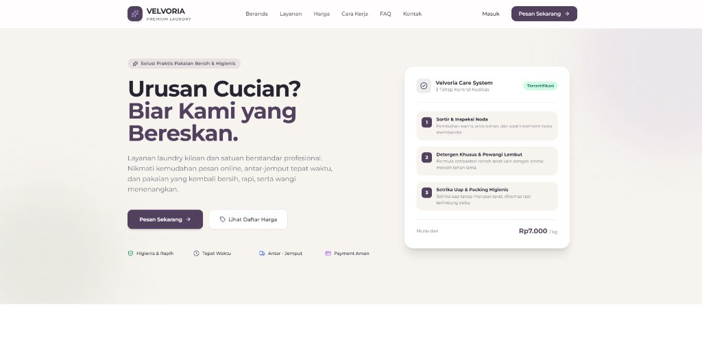
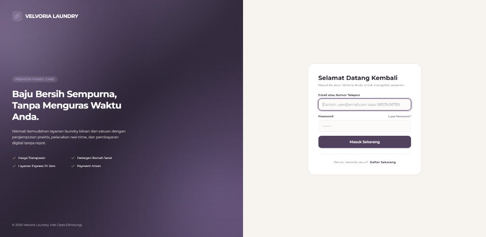
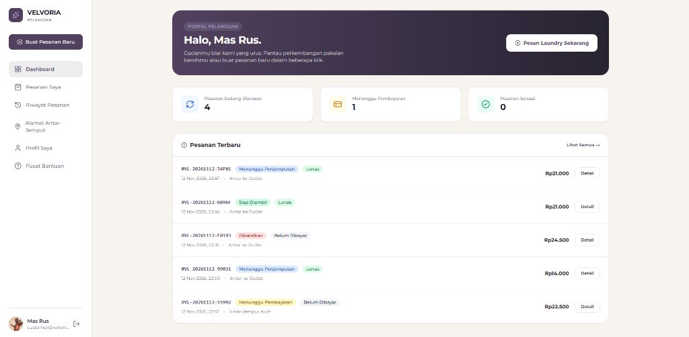
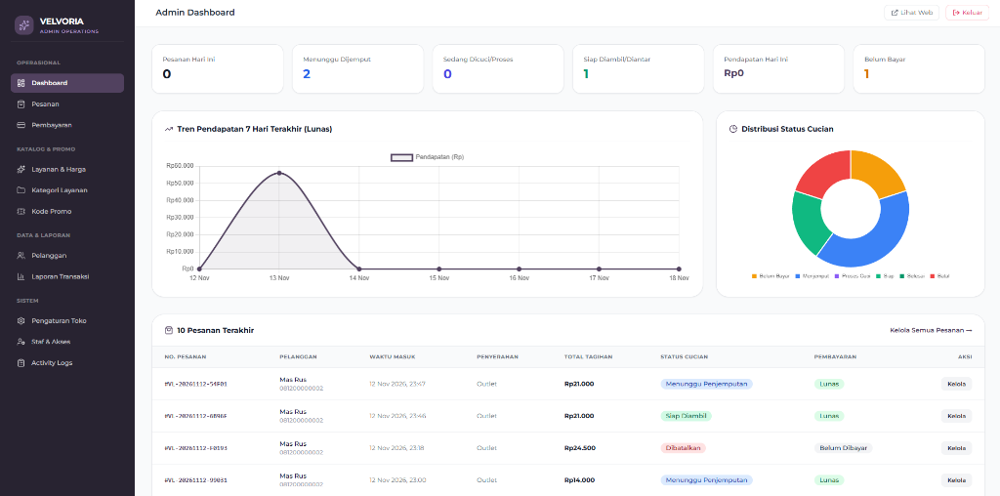

# Velvoria Laundry — Sistem Informasi & Pemesanan Laundry Online

**Velvoria Laundry** adalah aplikasi web manajemen dan pemesanan layanan laundry modern berbasis **CodeIgniter 4**, **MySQL/MariaDB**, **Tailwind CSS**, dan **Alpine.js** yang terintegrasi dengan pembayaran digital **Midtrans Snap**.

Aplikasi ini dirancang untuk memudahkan pelanggan memesan layanan laundry kiloan maupun satuan secara online (baik melalui penjemputan kurir antar-jemput maupun penyerahan langsung ke outlet), memantau progres cucian secara *real-time*, melakukan pembayaran digital yang aman, serta membantu pihak operasional/admin mengelola pesanan, layanan, promo, pelanggan, hingga laporan keuangan dalam satu panel terpadu.

---

## Tampilan Antarmuka (Preview)

### 1. Halaman Beranda (Landing Page)
Menampilkan informasi layanan unggulan, standar kualitas (*Velvoria Care System*), daftar harga, cara kerja, FAQ, dan informasi kontak outlet.



### 2. Halaman Autentikasi (Masuk & Daftar)
Halaman login dan registrasi pelanggan maupun admin dengan proteksi sesi per-perangkat (*multi-session database handler*) serta fitur pemulihan kata sandi melalui email.



### 3. Portal Pelanggan (Customer Dashboard)
Area khusus pelanggan untuk membuat pesanan baru, memantau status cucian yang sedang diproses, melihat tagihan yang menunggu pembayaran, mengelola buku alamat antar-jemput, memperbarui profil/avatar, dan mengunduh nota digital.



### 4. Panel Operasional Admin (Admin Dashboard)
Dashboard analitik dan operasional untuk memantau pesanan harian, grafik tren pendapatan 7 hari terakhir, distribusi status cucian, pembaruan berat aktual cucian, pencatatan pembayaran, manajemen katalog layanan, kode promo, staf, dan *activity logs*.



---

## Fitur Utama

### A. Halaman Publik (Guest)
- **Katalog Layanan & Daftar Harga**: Menampilkan layanan Laundry Kiloan dan Laundry Satuan beserta estimasi durasi pengerjaan.
- **Panduan Cara Kerja & FAQ**: Penjelasan alur pemesanan dari penjemputan hingga pengantaran dan tanya-jawab umum.
- **Kontak & Lokasi Outlet**: Formulir pesan pelanggan serta integrasi peta dan rute Google Maps berdasarkan pengaturan alamat toko.

### B. Portal Pelanggan (Customer)
- **Pemesanan Online Interaktif**:
  - Pilihan kategori layanan **Laundry Kiloan** dan **Laundry Satuan**.
  - Pilihan metode penyerahan: **Antar-Jemput Kurir** (dengan penjadwalan tanggal/jam jemput & ongkos kirim otomatis, gratis untuk nominal tertentu) atau **Antar Mandiri ke Outlet**.
  - Kalkulasi estimasi tagihan otomatis dan dukungan penggunaan **Kode Promo / Voucher Diskon**.
- **Pelacakan Status Real-Time**: Riwayat tahapan cucian mulai dari *Menunggu Penjemputan*, *Sedang Dicuci/Proses*, *Siap Diambil/Diantar*, hingga *Selesai*.
- **Pembayaran Digital & Nota Cetak**:
  - Pembayaran instan melalui QRIS, Virtual Account berbagai bank, e-Wallet, dan Kartu Kredit/Debit (terintegrasi dengan **Midtrans Snap**).
  - Cetak / unduh nota pesanan (*receipt*) resmi.
- **Manajemen Alamat & Profil**:
  - Buku alamat pelanggan (tambah, ubah, hapus, dan atur alamat utama penjemputan).
  - Pengaturan profil pelanggan, unggah foto profil (avatar), dan ubah password.

### C. Panel Admin & Operasional
- **Dashboard Analitik**: Ringkasan metrik harian (pesanan hari ini, menunggu dijemput, sedang diproses, siap diambil, pendapatan hari ini, belum bayar) dilengkapi grafik *Chart.js*.
- **Manajemen Pesanan**:
  - Pembaruan status cucian bertahap beserta pencatatan riwayat status (*order status history*).
  - Penyesuaian berat aktual (*actual weight*) untuk layanan kiloan dengan kalkulasi ulang tagihan secara otomatis.
  - Penambahan catatan internal admin dan cetak nota toko.
- **Manajemen Pembayaran**: Pemantauan transaksi pembayaran otomatis maupun konfirmasi pembayaran tunai (*manual mark as paid*) beserta log notifikasi webhook.
- **Manajemen Katalog & Promo**:
  - CRUD kategori layanan dan daftar layanan laundry (kode layanan, harga, satuan, minimal order, durasi jam, status aktif).
  - CRUD kode promosi (diskon persentase atau potongan nominal tetap, kuota penggunaan total & per pengguna, masa berlaku).
- **Manajemen Pelanggan, Staf & Sistem**:
  - Data pelanggan beserta histori transaksi dan pengaturan status akun.
  - Manajemen akun staf/admin.
  - Ekspor laporan transaksi ke format **CSV**.
  - Pengaturan informasi toko (nama toko, alamat, telepon, tarif antar-jemput, batas gratis ongkir) dan pencatatan **Activity Logs** admin.

---

## Teknologi yang Digunakan (Tech Stack)

- **Backend Framework**: CodeIgniter 4 (PHP 8.2+ / PHP 8.5)
- **Database**: MySQL / MariaDB (`utf8mb4`) dengan manajemen sesi berbasis database (`ci_sessions`)
- **Frontend Styling & Interaktivitas**: Tailwind CSS, Alpine.js, Lucide Icons, Chart.js
- **Payment Gateway**: Midtrans PHP SDK (`midtrans/midtrans-php` — Snap API & Webhook Notification)
- **Autentikasi & Keamanan**: Proteksi CSRF, filter akses berbasis role (`admin`, `customer`, `guest`), regenerasi sesi login, dan token reset password sekali pakai.

---

## Persyaratan Sistem

Sebelum menginstal proyek ini, pastikan perangkat Anda telah terpasang:
1. **PHP** versi `8.2` ke atas (direkomendasikan **PHP 8.5.x**) dengan ekstensi berikut aktif di `php.ini`:
   - `intl`
   - `mbstring`
   - `mysqli`
   - `curl`
   - `json`
   - `fileinfo`
   - `openssl`
2. **Composer** (Dependency Manager untuk PHP)
3. **MySQL** atau **MariaDB** (melalui XAMPP / Laragon / instalasi mandiri)
4. **Apache Web Server** dengan modul `mod_rewrite` aktif (atau menggunakan built-in server `php spark serve`)

---

## Panduan Instalasi Lengkap

### 1. Clone Repositori
Clone repositori ini ke dalam direktori web server Anda (misalnya `C:\xampp\htdocs\VelvoriaLaundry` pada XAMPP):

```bash
git clone https://github.com/LoremipRenn/Velvoria-Laundry.git
cd Velvoria-Laundry
```

### 2. Instal Dependensi Composer
Jalankan perintah berikut di terminal pada root folder proyek:

```bash
composer install
```

### 3. Konfigurasi File Environment (`.env`)
Salin file template `.env.example` menjadi `.env`:

```bash
cp .env.example .env
```
*(Pada Windows PowerShell/CMD: `copy .env.example .env`)*

Buka file `.env` dan sesuaikan konfigurasi berikut:

```ini
CI_ENVIRONMENT = development
app.baseURL = 'http://localhost/VelvoriaLaundry/'
app.appTimezone = 'Asia/Jakarta'

# Konfigurasi Database MySQL/MariaDB
database.default.hostname = localhost
database.default.database = velvoria_laundry
database.default.username = root
database.default.password =
database.default.DBDriver = MySQLi
database.default.port = 3306

# Kredensial Midtrans (Gunakan Key dari Dashboard Midtrans Sandbox/Production)
MIDTRANS_SERVER_KEY = YOUR_SERVER_KEY
MIDTRANS_CLIENT_KEY = YOUR_CLIENT_KEY
midtrans.isProduction = false
midtrans.isSanitized = true
midtrans.is3ds = true

# Kredensial Admin Awal (Digunakan saat menjalankan DatabaseSeeder)
velvoria.adminEmail = 'admin@velvoria.test'
velvoria.adminName = 'Admin Velvoria'
velvoria.adminPhone = '081234567890'
velvoria.adminPassword = 'PasswordAdminMinimal12Karakter'
```

### 4. Siapkan Database
Buat database baru bernama `velvoria_laundry` di phpMyAdmin atau MySQL CLI:

```sql
CREATE DATABASE velvoria_laundry CHARACTER SET utf8mb4 COLLATE utf8mb4_unicode_ci;
```

Anda dapat mengisi struktur tabel dan data awal menggunakan **salah satu** dari dua metode berikut:

#### Opsi A — Menggunakan Migration & Seeder CodeIgniter (Disarankan)
Pastikan `velvoria.adminPassword` di `.env` sudah diisi minimal 12 karakter, lalu jalankan:

```bash
php spark migrate
php spark db:seed DatabaseSeeder
```
Perintah ini akan membuat seluruh tabel (termasuk tabel sesi `ci_sessions`) serta mengisi kategori layanan, daftar layanan awal, pengaturan toko, dan akun admin.

#### Opsi B — Import File SQL
Import file `database/velvoria_laundry.sql` secara langsung ke database `velvoria_laundry` melalui **phpMyAdmin**.

### 5. Menjalankan Aplikasi

#### Menggunakan XAMPP / Apache
1. Pastikan modul **Apache** dan **MySQL** sudah berjalan di XAMPP Control Panel.
2. Pastikan `app.baseURL` di `.env` sesuai dengan URL folder Anda (contoh: `http://localhost/VelvoriaLaundry/`).
3. Buka browser dan akses:
   ```text
   http://localhost/VelvoriaLaundry/
   ```

#### Menggunakan Server Bawaan CodeIgniter (`spark serve`)
Jika menggunakan `php spark serve`, sesuaikan `app.baseURL` di `.env` menjadi `http://localhost:8080/`, lalu jalankan:

```bash
php spark serve
```
Kemudian buka `http://localhost:8080` di browser.

---

## Struktur Direktori Utama

```text
VelvoriaLaundry/
├── app/
│   ├── Config/          # Konfigurasi aplikasi, rute (Routes.php), filter, sesi, dan Midtrans
│   ├── Controllers/     # Controller untuk Guest, Auth, Customer, Admin, dan Payment Webhook
│   ├── Database/        # File Migrations dan Seeds (DatabaseSeeder, AdminSeeder, ServiceSeeder, dll.)
│   ├── Filters/         # Middleware autentikasi dan otorisasi role (AuthFilter, GuestFilter, RoleFilter)
│   ├── Helpers/         # Helper format mata uang, tanggal, dan badge status (velvoria_helper.php)
│   ├── Models/          # Model interaksi database
│   ├── Services/        # Business logic (OrderService, PricingService, PromotionService, MidtransService)
│   └── Views/           # Template antarmuka (layouts, guest, auth, customer, admin, payment)
├── database/
│   └── velvoria_laundry.sql  # Dump SQL alternatif untuk instalasi cepat
├── docs/
│   └── screenshots/     # Gambar dokumentasi tampilan website untuk README
├── public/              # Entry point publik, aset statis, dan folder unggahan avatar
├── tests/               # Pengujian unit dan integrasi
├── writable/            # Penyimpanan cache, logs, dan file runtime
├── .env.example         # Template konfigurasi environment
└── composer.json        # Definisi dependensi PHP
```

---

## Lisensi

Proyek ini dilisensikan di bawah [MIT License](LICENSE).
